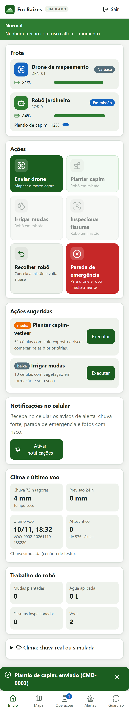
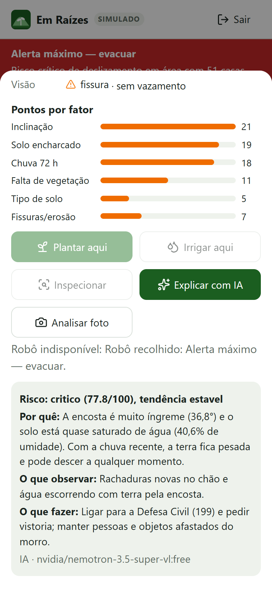
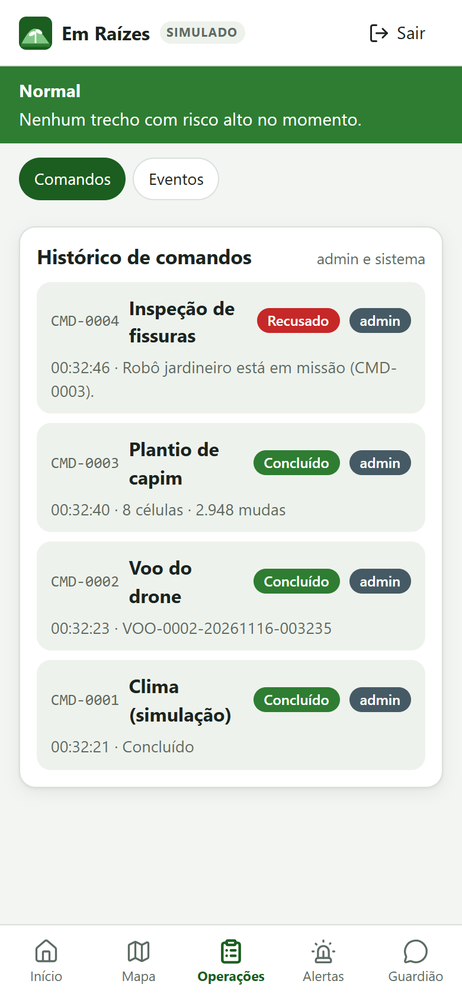
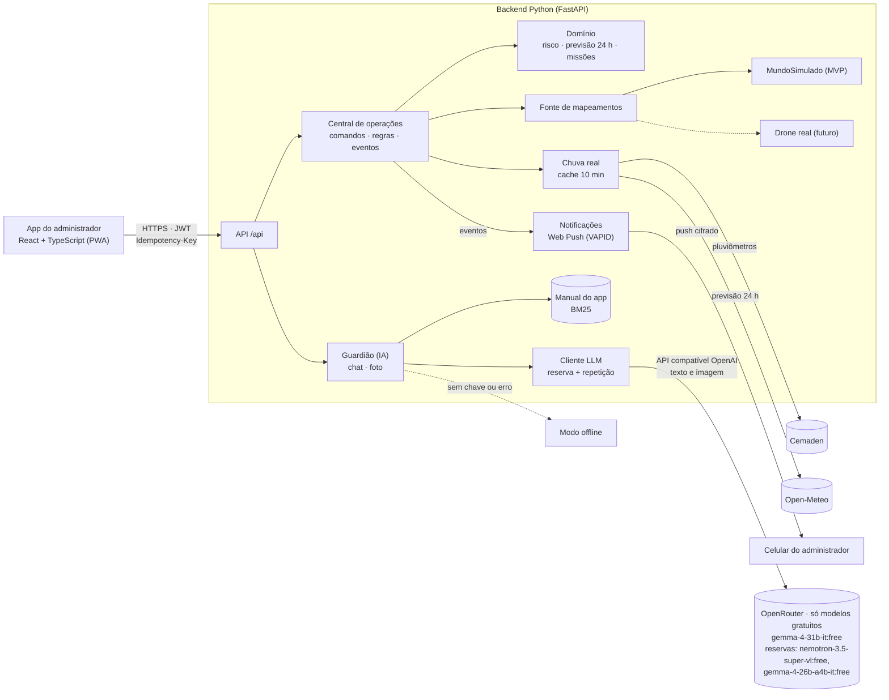
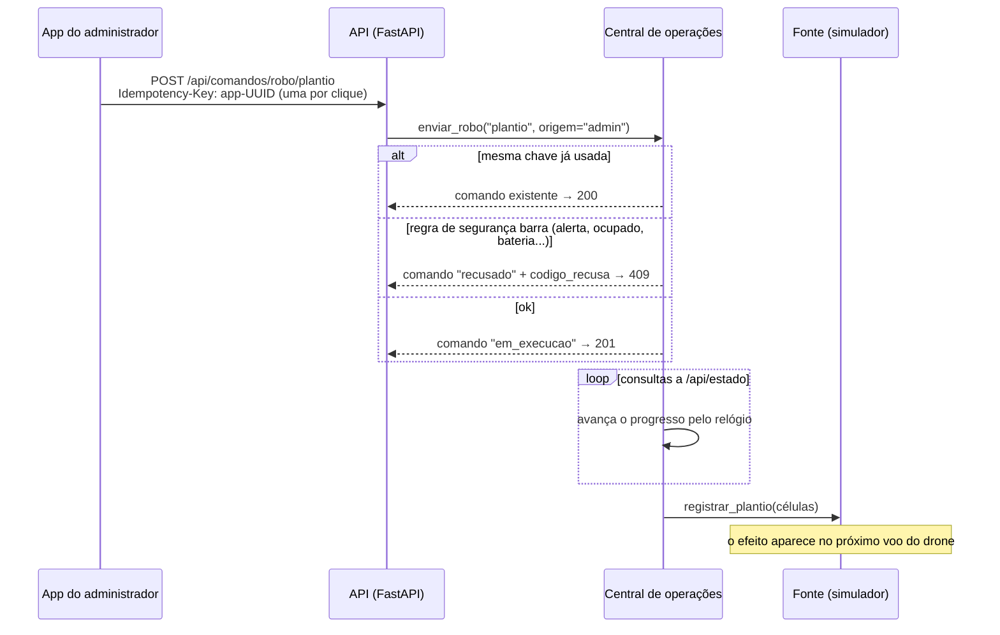

# 🌱 Em Raízes

**App do administrador para um drone com IA e um robô jardineiro que plantam capim-vetiver e ajudam a prevenir deslizamentos em morros de comunidades.**
Projeto do desafio **CitizenTech** (disciplinas *Generative AI for Engineering* e *Secure DevOps Tools & Cloud Computing*).

> ⚠️ **MVP acadêmico com dados SIMULADOS.** Não existe drone nem robô físico ainda nessa versão e o índice de risco usa pesos ilustrativos.
>
> A **chuva é real**: pluviômetros do Cemaden e previsão do Open-Meteo para Petrópolis/RJ (configurável).

<p align="center">
  
  
  
</p>

---

## Ficha Técnica do MVP

| | |
|---|---|
| **MVP no ar** | <https://ca-emraizes.jollysand-e662ba59.eastus2.azurecontainerapps.io> · versão em execução: [`/api/saude`](https://ca-emraizes.jollysand-e662ba59.eastus2.azurecontainerapps.io/api/saude) |
| **Stack** | Python 3.12 + FastAPI (API) · React + TypeScript/Vite (PWA) · uma imagem Docker |
| **Nuvem** | Microsoft Azure (Azure for Students) · região **East US 2** · resource group `rg-emraizes` |
| **Execução** | Azure Container Apps (Consumption) · 1 réplica · 0,5 vCPU / 1 GiB · ingress só HTTPS, sem porta de administração |
| **Imagens** | Azure Container Registry Basic · pull por identidade gerenciada (sem usuário admin) |
| **Infraestrutura como código** | Terraform (`azurerm` 4.x) em [`infra/`](infra/) · state remoto num Storage Account (`rg-tfstate`) |
| **CI/CD** | GitHub Actions ([`ci.yml`](.github/workflows/ci.yml)): Gitleaks · Semgrep · testes · build · Trivy · docker compose · deploy automático |
| **Segredos** | GitHub Secrets (`AZURE_CREDENTIALS`) · secrets do Container App · `.env`/`terraform.tfvars` fora do Git |
| **Observabilidade** | Azure Monitor (4 sinais de ouro) · Log Analytics · Application Insights (teste de disponibilidade) · alertas por e-mail |
| **Custo estimado** | ≈ US$ 24/mês (detalhes na seção 6) |
| **Disciplinas** | *Generative AI for Engineering* · *Secure DevOps Tools & Cloud Computing* |

## 1. Problema escolhido

Milhões de brasileiros moram em encostas ocupadas sem planejamento. Na época de chuvas, deslizamentos destroem casas
e matam pessoas, muitas vezes porque o aviso chega tarde. Duas frentes ajudam muito e são baratas:
**vegetação com raiz profunda** (o capim-vetiver segura o solo) e **alerta antecipado** (sair de casa antes do deslizamento).

**Ideia completa:** um drone com IA mapeia o morro (relevo, umidade, vegetação, trincas) e passa as informações para um
robô jardineiro que planta e rega capim-vetiver nos pontos certos. Um aplicativo controla tudo, prevê pioras nas
próximas 24 h e tem um chat de IA. No futuro, uma automação **RPA** (um fluxo no UiPath, desenvolvido em outra
disciplina e fora deste repositório) vai acionar o drone e o robô sozinha, a partir dos dados do drone.

**Este MVP:** o **app do administrador** (os moradores ainda não usam o app) com botões para enviar o drone e mandar o
robô plantar, irrigar e inspecionar; a **API** do app; e o **Guardião**, um *helper* de IA generativa que tira
dúvidas sobre o app (como usar, funcionalidades, códigos de recusa e erros comuns). Drone, robô e sensores são **simulados**.

Três recursos levam o projeto além da simulação:
- **Chuva real:** o risco e as sugestões reagem à chuva medida pelos pluviômetros do Cemaden e à previsão de 24 h.
- **Notificações no celular** (Web Push): o aviso chega mesmo com o app fechado quando o alerta muda, a chuva piora,
  a frota para ou uma foto mostra risco.
- **Foto analisada por IA** (multimodal): o administrador fotografa uma trinca ou encosta e recebe uma triagem visual.

## 2. O que o app faz

App web **mobile-first**, instalável no celular (PWA), com 5 telas. No computador (a partir de 1024 px) ganha menu lateral,
telas em duas colunas e o detalhe da célula fixo ao lado do mapa; no celular o layout continua o mesmo.

| Tela | O que tem |
|---|---|
| 🏠 **Início** | Frota (drone DRN-01 e robô ROB-01: status, bateria, progresso da missão) e os botões **Enviar drone · Plantar capim · Irrigar mudas · Inspecionar fissuras · Recolher robô · Parada de emergência / Liberar frota**. Também: **ações sugeridas** com botão "Executar", **notificações no celular** (ativar e testar), **chuva real** × último voo, trabalho do robô e a troca entre chuva real e simulada. |
| 🗺️ **Mapa** | Morro em células de 10 m × 10 m. Camadas: risco agora, risco em 24 h, umidade, vegetação e **foto do drone** (imagem aérea simulada). Toque na célula: dados, pontos de cada fator, **Plantar aqui / Irrigar aqui / Inspecionar**, **Explicar com IA** e **Analisar foto** (já com o código da célula). |
| 📋 **Operações** | Histórico de comandos (admin e sistema) com status, resultado, células ignoradas e código de recusa; diário de eventos. |
| 🚨 **Alertas** | Nível, casas e pessoas em risco, chuva de 7 dias + previsão, lista de evacuação, **SMS gerado por IA** (validado) e **plano de ação em JSON** (validado com Pydantic). |
| 💬 **Guardião** | Chat de IA ancorado no manual do app e na situação atual (voo, alerta, frota, últimos comandos). Funciona em **modo offline** sem chave. O botão de câmera envia uma **foto para triagem visual** pela IA. |

**Regras de segurança** (ficam no servidor): o robô é recolhido com nível Alerta/Alerta máximo;
nunca irriga encosta encharcada, com risco alto ou com chuva prevista; não atua em células com casas nem acima de 35°;
um dispositivo ocupado ou com bateria baixa recusa o comando; a parada de emergência cancela tudo até liberar a frota.
Plantio e irrigação só aparecem no mapa **depois do próximo voo** do drone, como na vida real.

## 3. Arquitetura da solução



**Como um comando passa pelo sistema** (clique em "Plantar capim"):



| Pasta / módulo | Responsabilidade |
|---|---|
| `backend/src/em_raizes/dominio/` | Regras puras: `modelos.py` (Mapeamento, constantes), `risco.py` (índice 0–100, previsão 24 h, alerta, plantio, irrigação), `missoes.py` (fila e rota do robô). |
| `backend/src/em_raizes/fontes/` | De onde vêm os dados: `simulador.py` (voo simulado + `MundoSimulado`, que guarda o efeito do robô), `chuva.py` (chuva real: Cemaden + Open-Meteo, com cache e plano B). Quando existir o drone real, entra uma nova fonte no lugar do `MundoSimulado`. |
| `backend/src/em_raizes/operacoes/` | `central.py`: comandos, regras de segurança, idempotência, progresso por tempo, chuva real, eventos e ações sugeridas. `notificacoes.py`: Web Push (VAPID) disparado pelos eventos. |
| `backend/src/em_raizes/ia/` | `llm.py` (OpenRouter com reserva e repetição), `prompts.py`, `conhecimento.py` + `conhecimento/manual.md` (RAG BM25), `guardiao.py` (chat, SMS, plano JSON, modo offline, camada de segurança), `visao.py` (triagem de foto, JSON validado), `conversa.py` (histórico, janela de contexto, streaming) e `chat_terminal.py`. |
| `backend/src/em_raizes/api/` | `main.py` (rotas FastAPI e entrega do app compilado), `seguranca.py` (login JWT). |
| `backend/src/em_raizes/config.py` | Configuração por variáveis de ambiente (dev/produção). |
| `frontend/` | App do administrador em React + TypeScript (Vite), PWA. |
| `notebooks/` | Notebook da disciplina (usa o mesmo pacote do backend). |

**Índice de risco** = declividade (28%) + saturação do solo (22%) + chuva 72 h (18%) + falta de vegetação (12%) +
tipo de solo (10%) + sinais visíveis (10%), reduzido em terreno quase plano. Classes: baixo (<30), moderado (30–54),
alto (55–74), crítico (≥75). Casas em célula crítica ou até 2 células morro abaixo dela entram na lista de evacuação.

## 4. Modelo de IA e motivo da escolha

| | |
|---|---|
| Modelo principal | `google/gemma-4-31b-it:free` (Gemma 4 31B, via OpenRouter) |
| Reservas | `nvidia/nemotron-3.5-super-vl:free` (outro provedor) e `google/gemma-4-26b-a4b-it:free` |
| Custo | **zero**: só variantes `:free` (US$ 0 por token; a conta não precisa de créditos) |

Motivos: **100% gratuito** (um projeto social não pode depender de cartão de crédito), **pesos abertos** (o Gemma 4 pode
rodar num servidor próprio no futuro, sem mandar dados para fora), **multimodal** (o mesmo modelo faz a triagem de fotos),
**saída JSON** e contexto de 262 mil tokens. A primeira reserva é da NVIDIA porque os dois Gemma gratuitos têm o mesmo
provedor (Google AI Studio): se ele limitar as chamadas, os dois caem juntos.

O preço de ser gratuito são os limites do OpenRouter: **20 chamadas por minuto** e **50 por dia** numa conta que nunca
comprou créditos. O cliente espera cerca de 3 s entre chamadas para respeitar o limite por minuto; o notebook inteiro faz
cerca de 40 chamadas. Configurável em `.env` (`OPENROUTER_MODEL`, `OPENROUTER_FALLBACK_MODELS`). Detalhes na seção
"Troca do modelo via API" do notebook.

## 5. Como rodar (desenvolvimento)

Pré-requisitos: **Python 3.11+** (testado com 3.12) e **Node.js 22+** (testado com 24).

```bash
python -m venv .venv
```

Ative o ambiente — Windows: `.venv\Scripts\activate` · Linux/Mac: `source .venv/bin/activate`

```bash
pip install -r requirements.txt
```

Copie `.env.example` para `.env` e preencha pelo menos `EM_RAIZES_ADMIN_SENHA` (login do app). Opcional:
`OPENROUTER_API_KEY` (IA online e análise de foto; a conta gratuita basta, sem créditos).
A chuva real precisa de internet no servidor; sem ela, o app começa com a chuva simulada. Para outra cidade, ajuste as
variáveis `EM_RAIZES_CHUVA_*`. As chaves das notificações são geradas sozinhas em `.dados/` no desenvolvimento.

Terminal 1 — API em <http://localhost:8000> (documentação em <http://localhost:8000/docs>):

```bash
python -m uvicorn em_raizes.api.main:criar_app --factory --reload --port 8000
```

Terminal 2 — app do administrador em <http://localhost:5173> (o Vite repassa `/api` para a porta 8000):

```bash
cd frontend && npm install && npm run dev
```

Para testar no celular na mesma rede Wi-Fi, rode `npm run dev -- --host` e abra o endereço que aparecer.

**Notificações:** funcionam no app compilado (`cd frontend && npm run build`, aberto em <http://localhost:8000>) ou
instalado, no Chrome/Edge (inclusive Android). No iPhone, só com o app adicionado à tela inicial. Fora de `localhost`,
o navegador exige HTTPS.

**Testes**

```bash
pytest backend -q
```

```bash
cd frontend && npm run typecheck && npm test
```

**Notebook do começo ao fim** (gera as saídas visíveis):

```bash
jupyter nbconvert --to notebook --execute --inplace notebooks/Aula09.3_Chat_Guardiao.ipynb
```

## 6. Secure DevOps: CI/CD, nuvem e observabilidade

> Ninguém publica clicando em botão: toda mudança passa pelo pipeline, que barra segredo vazado e vulnerabilidade
> antes de qualquer coisa chegar ao cidadão.

### Container

**Uma imagem só:** o [`Dockerfile`](Dockerfile) compila o frontend (Node) e o coloca dentro da imagem Python; o FastAPI
serve a API em `/api` e o app em `/`. A imagem é multi-stage, roda como **usuário não root** (`uid 10001`), aplica as
atualizações de segurança do Debian no build e não leva nenhum segredo (o [`.dockerignore`](.dockerignore) exclui `.env`
e `.git`). Em produção (`EM_RAIZES_AMBIENTE=producao`) o servidor **não sobe** sem `EM_RAIZES_ADMIN_SENHA` e
`EM_RAIZES_SEGREDO_JWT`.

```bash
cp .env.example .env          # preencha EM_RAIZES_ADMIN_SENHA e EM_RAIZES_SEGREDO_JWT
docker compose up -d --build  # http://localhost:8000
curl http://localhost:8000/api/saude
docker compose down
```

O [`docker-compose.yml`](docker-compose.yml) sobe a mesma imagem de produção com `no-new-privileges` e `cap_drop: ALL`.

### Pipeline (GitHub Actions)

[`.github/workflows/ci.yml`](.github/workflows/ci.yml) roda em todo *push* e *pull request*:

| Job | O que verifica | Barra o build? |
|---|---|---|
| Segredos (Gitleaks) | histórico completo do Git atrás de chaves e senhas | sim |
| SAST (Semgrep) | código inseguro em Python, TypeScript, workflows e Terraform (`p/default`) | sim |
| Backend | `ruff check`, `ruff format --check` e `pytest` | sim |
| Frontend | `tsc` (tipos), `vitest` e `vite build` | sim |
| Notebook | executa o notebook do começo ao fim em modo offline | só o deploy |
| Imagem | `docker compose build`, **Trivy** (bloqueia HIGH/CRITICAL com correção), sobe a stack e testa `/api/saude`; na `main`, envia a imagem ao ACR | sim |
| Deploy | só num *push* na `main` e só se **todos** os jobs passarem: atualiza o Container App para a imagem deste commit, espera `/api/saude` mostrar o commit e faz um teste de fumaça | — |

As actions são fixadas por SHA de commit, e o workflow só tem permissão de leitura no repositório. Falsos positivos
revisados do Gitleaks ficam em [`.gitleaksignore`](.gitleaksignore), identificados pelo fingerprint.

### Infraestrutura (Terraform + Azure)

Toda a nuvem é criada pelo Terraform em [`infra/`](infra/): resource group, Container Registry, identidade gerenciada
(AcrPull), ambiente e app do Container Apps, Log Analytics, Application Insights, teste de disponibilidade e alertas.
O `terraform.tfstate` fica num Storage Account remoto e o `terraform.tfvars` (com a senha do admin) nunca vai para o Git.
O segredo JWT é gerado pelo próprio Terraform.

Passo a passo completo, inclusive as pegadinhas do Azure for Students: [`docs/DEPLOY.md`](docs/DEPLOY.md).

### Observabilidade

Painel *Em Raízes - Golden Signals* no Azure Monitor com os 4 sinais de ouro, e dois alertas por e-mail definidos em
[`infra/monitoring.tf`](infra/monitoring.tf):

| Sinal | Métrica |
|---|---|
| Tráfego | `Requests` do Container App (soma por minuto) |
| Saturação | uso de CPU e memória do Container App |
| Latência | duração do teste de disponibilidade em `/api/saude` (São Paulo e Virgínia, a cada 5 min) |
| Erros | % de sucesso do teste de disponibilidade |

| Alerta | Condição |
|---|---|
| `alerta-pico-requisicoes-emraizes` | mais de 40 requisições em 5 min (uso normal: 0 a 3/min): força bruta ou varredura |
| `alerta-indisponivel-emraizes` | disponibilidade do `/api/saude` abaixo de 90% em 15 min |

Neste ambiente, a métrica `Requests` não expõe as dimensões de código HTTP, por isso os alertas usam o total de
requisições e o teste externo, e não 4xx/5xx.

### Custo estimado (Azure, East US, preço de lista)

| Item | US$/mês |
|---|---|
| Container Apps (0,5 vCPU + 1 GiB sempre ligado, já descontada a cota gratuita, taxa ociosa) | ≈ 10,05 |
| Container Registry Basic | ≈ 5,01 |
| Teste de disponibilidade (2 locais, a cada 5 min) | ≈ 8,64 |
| Log Analytics, App Insights (dentro dos 5 GB gratuitos), alertas e storage do state | ≈ 0,25 |
| **Total** | **≈ 24** |

Se a CPU ficasse ativa o tempo todo, o total chegaria a cerca de US$ 47. Depois da avaliação: `terraform destroy`.

## 7. Notebook (entrega obrigatória)

[`notebooks/Aula09.3_Chat_Guardiao.ipynb`](notebooks/Aula09.3_Chat_Guardiao.ipynb) parte do notebook da aula
**"Aula 09.3 - Construindo um Chat com LLMs"** (canal GENERATIVE AI for ENGINEERING > Compartilhado): as 7 células
originais continuam lá (2 delas alteradas) e o Guardião do projeto virou um **chat de terminal com histórico e streaming**.
As 15 células de código novas ou alteradas estão marcadas com `# MODIFICACAO-ALUNO`. Como o notebook da aula vinha
quase vazio, todo o texto em markdown escrito depois das células originais é nosso (explicado no topo do notebook).

| Requisito do professor | Onde está no notebook |
|---|---|
| Trocar o modelo via API e registrar o motivo | "Troca do modelo via API": a aula usava a API da OpenAI; trocamos para OpenRouter `google/gemma-4-31b-it:free` (100% gratuito, + 2 reservas gratuitas), com motivo, limites do plano gratuito e conferência no catálogo |
| Reescrever ≥ 3 prompts com justificativa em markdown | Prompt de sistema (role `system`) · prompt de resumo do histórico (janela de contexto) · prompt de reformulação da pergunta de acompanhamento |
| ≥ 3 células novas com experimentos | Streaming × resposta inteira · com × sem histórico · janela de contexto · triagem em JSON (Pydantic) · tratamento de erros (401 real, falha antes e no meio do streaming) · segurança na conversa |
| Marcação de cada modificação | `# MODIFICACAO-ALUNO` nas células de código; os markdowns depois das células originais são todos nossos (nota no topo do notebook) |
| Notebook executado com saídas | Sim (ver observação abaixo) |
| Entrega da aula: "chat funcional em terminal" | `python -m em_raizes.ia.chat_terminal` (código em `backend/src/em_raizes/ia/conversa.py` e `chat_terminal.py`) |

> **Observação:** a versão atual foi executada **com** `OPENROUTER_API_KEY` em 16/11/2026. Nesse dia o provedor
> gratuito do Gemma (Google AI Studio) estava sobrecarregado (erro 429), então as respostas vieram do modelo reserva
> `nvidia/nemotron-3.5-super-vl:free`: é a troca automática que o notebook descreve. Para rodar de novo:
> `jupyter nbconvert --to notebook --execute --inplace notebooks/Aula09.3_Chat_Guardiao.ipynb` (uma execução completa
> usa cerca de 40 das 50 chamadas gratuitas do dia).

**Chat de terminal do Guardião**

```bash
python -m em_raizes.ia.chat_terminal
```

Comandos: `/historico`, `/resumo`, `/tokens`, `/limpar`, `/sair`. Sem chave, responde em modo offline (regras + manual),
também aos pedaços. Exemplo de sessão: [`docs/evidencias/chat_terminal_offline.txt`](docs/evidencias/chat_terminal_offline.txt).

## 8. Exemplos de prompts e saídas

**Prompt de sistema do Guardião (trecho)**, versão completa em `backend/src/em_raizes/ia/prompts.py`:

```text
Você é o Guardião, assistente do aplicativo Em Raízes [...]
QUEM USA: o administrador da operação [...]
REGRAS
- Use somente as informações do CONTEXTO e do MANUAL. Se a resposta não estiver lá, diga que não sabe [...]
- Segurança em primeiro lugar: se a pessoa relatar trincas novas, estalos, [...] oriente a ir para um local
  seguro e ligar para a Defesa Civil (199) ou Bombeiros (193). Nunca afirme que um local "está seguro".
COMO RESPONDER
- Português do Brasil, frases curtas, sem jargão [...] No máximo 120 palavras [...]
```

**Prompt do SMS** e saída que passa na validação (plano B, cenário *tempestade extrema*):

```text
Regras: no máximo 160 caracteres; comece com o nível; verbo no imperativo; setor e ponto de apoio;
termine com "Defesa Civil 199"; sem emojis, pânico, jargão ou dados inventados.
```

```text
ALERTA MÁXIMO: risco de deslizamento no setor Meio-Leste e Meio-Oeste. Saia de casa agora e vá para a Escola Municipal. Defesa Civil 199
(136/160 caracteres · regras ok)
```

**Plano de ação em JSON** (validado por Pydantic; trecho do plano por regras, cenário *tempestade extrema*):

```json
{
  "nivel_alerta": "alerta_maximo",
  "resumo": "Alerta máximo — evacuar: Risco crítico de deslizamento em área com 51 casas (~143 pessoas).",
  "acoes": [
    {"prioridade": 1, "tipo": "evacuacao", "local": "L06C17, L08C18, L05C13, L08C01, L06C16, L09C23",
     "descricao": "Retirar ~143 pessoas e levar ao ponto de apoio.", "responsavel": "defesa_civil"},
    {"prioridade": 2, "tipo": "inspecao", "local": "L06C17, L06C16, L09C23, ...",
     "descricao": "Vistoriar fissuras detectadas pela visão computacional.", "responsavel": "defesa_civil"},
    {"prioridade": 5, "tipo": "plantio", "local": "L06C01, L08C19, ...",
     "descricao": "Plantio de capim-vetiver adiado até o fim do alerta.", "responsavel": "robo_jardineiro"}
  ]
}
```

**Comando recusado** (o administrador tentou inspecionar com o robô ocupado; resposta 409):

```json
{"id": "CMD-0004", "tipo": "inspecao", "origem": "admin", "status": "recusado",
 "codigo_recusa": "dispositivo_ocupado", "motivo": "Robô jardineiro está em missão (CMD-0003)."}
```

**Chat com IA** (alerta máximo; resposta do modelo reserva `nvidia/nemotron-3.5-super-vl:free`), pergunta
"Tem uma trinca nova na parede e está chovendo":

```text
Saia de casa imediatamente e vá para um local seguro. Não espere.
Ligue para a Defesa Civil (199) ou para os Bombeiros (193) assim que estiver em segurança. [...]
Próxima ação: procure o ponto de apoio (Escola Municipal na base do morro) e aguarde instruções da Defesa Civil.
```

Sem chave, a mesma pergunta cai no modo offline (regras + manual), que também manda ligar 199/193.

Resultados do notebook executado com IA: o prompt de sistema novo cita o 199 (o original não) e responde em 69 palavras
(o original, em 190); o primeiro texto do streaming aparece em **0,55 s**, contra 6,8 s da resposta inteira; com histórico
a busca acha o trecho de irrigação e a resposta explica as regras do botão Irrigar, e sem histórico a busca cai no trecho
de Clima e a resposta fala do cenário seco em geral; a reformulação leva a busca ao trecho certo do manual; a triagem em
JSON classificou as 5 mensagens (a emergência com urgência alta e "precisa de humano"). Nos testes de segurança, as
respostas passaram em **4 de 4**: citam o 199 na emergência, encaminham a obra para a Defesa Civil e não afirmam que um
lugar está seguro (ver Limitações).

## 9. Evidências de execução

| Evidência | Arquivo |
|---|---|
| Início após login | [`00_login_e_inicio.png`](docs/evidencias/00_login_e_inicio.png) |
| Robô plantando (progresso e botões bloqueados enquanto ocupado) | [`01_inicio_robo_plantando.png`](docs/evidencias/01_inicio_robo_plantando.png) |
| Mapa: detalhes da célula + explicação da IA (risco crítico) | [`02_mapa_celula.png`](docs/evidencias/02_mapa_celula.png) |
| Mapa: foto do drone (simulada) | [`03_mapa_foto_drone.png`](docs/evidencias/03_mapa_foto_drone.png) |
| Operações: histórico de comandos, com recusa | [`04_operacoes_comandos.png`](docs/evidencias/04_operacoes_comandos.png) |
| Clima mudou: sugestão de enviar o drone | [`05_sugestao_enviar_drone.png`](docs/evidencias/05_sugestao_enviar_drone.png) |
| Alerta máximo: robô recolhido por segurança | [`06_alerta_maximo_robo_bloqueado.png`](docs/evidencias/06_alerta_maximo_robo_bloqueado.png) |
| Alertas: SMS e plano de ação | [`07_alertas_sms_plano.png`](docs/evidencias/07_alertas_sms_plano.png) |
| Chat do Guardião com IA (alerta máximo: dúvida de uso e emergência) | [`08_guardiao_chat.png`](docs/evidencias/08_guardiao_chat.png) |
| Documentação da API (Swagger) | [`09_api_docs_swagger.png`](docs/evidencias/09_api_docs_swagger.png) |
| Chuva real de Petrópolis (Cemaden + Open-Meteo) e cartão de notificações | [`10_chuva_real_e_notificacoes.png`](docs/evidencias/10_chuva_real_e_notificacoes.png) |
| Analisar foto com IA (imagem aérea simulada: a IA marca risco indeterminado e pede uma foto melhor) | [`11_foto_com_ia.png`](docs/evidencias/11_foto_com_ia.png) |
| Dados simulados de um voo do drone (576 células, com abas Sobre e Dicionário das colunas) | [`dados_simulados_em_raizes.xlsx`](docs/dados/dados_simulados_em_raizes.xlsx) |
| Sessão no chat de terminal (histórico, reformulação, emergência, comandos) | [`chat_terminal_offline.txt`](docs/evidencias/chat_terminal_offline.txt) |
| Testes do backend (103, pytest) e do frontend (19, vitest) — inclui streaming, histórico, envio real de push cifrado e o dropdown do clima | [`testes_backend.txt`](docs/evidencias/testes_backend.txt) · [`testes_frontend.txt`](docs/evidencias/testes_frontend.txt) |
| Notebook executado (entrega obrigatória) | [`notebooks/Aula09.3_Chat_Guardiao.ipynb`](notebooks/Aula09.3_Chat_Guardiao.ipynb) |

## 10. Limitações

- Drone, sensores, visão computacional do drone e robô são **simulados**; o morro é fictício. A chuva é real.
- A chuva real é da cidade (percentil 75 dos pluviômetros ativos), não do ponto exato do morro; a previsão é de modelo
  (Open-Meteo). O INMET seria a fonte oficial de previsão, mas a API dele não estava acessível neste MVP.
- A análise de foto é uma triagem visual da IA: pode errar, depende da qualidade da foto e não substitui vistoria.
- Push: as inscrições ficam em memória (o app reenvia ao abrir); navegadores embutidos, modo anônimo e o Edge/Chrome
  em modo headless recusam a inscrição. O envio foi testado com criptografia real contra um endpoint local.
- O índice de risco é uma fórmula explicável com **pesos ilustrativos**, não um modelo treinado nem validado por geólogos.
- O estado (comandos, eventos, voos) fica **na memória** de um único processo: reiniciar apaga o histórico, e não dá para
  rodar várias réplicas. Próximo passo: banco de dados (ex.: PostgreSQL).
- Um único usuário administrador; ainda não há perfis (operador, Defesa Civil) nem auditoria persistente.
- A busca no manual é léxica (BM25): sinônimos muito diferentes podem não achar o trecho certo.
- O LLM pode errar mesmo com ancoragem; as checagens automáticas são simples. O teste de segurança do notebook olha
  cada oração: reprova "a casa está segura" e aceita "não posso afirmar que a casa está segura". Com IA passou em 4 de 4,
  mas uma regra assim pode deixar passar uma afirmação escrita de outro jeito; por isso o notebook também mostra as frases
  com "seguro", para uma pessoa conferir.
- O provedor gratuito do Gemma pode ficar lotado (aconteceu em 16/11/2026); aí o app usa o Nemotron, que é um modelo
  de raciocínio. O raciocínio fica desligado, senão ele gasta o limite de tokens "pensando" e a resposta vem vazia.
- A IA é gratuita e por isso tem cota: 20 chamadas por minuto e 50 por dia no OpenRouter. Em horário de pico pode haver
  fila ou erro 429, e um modelo pode sair do plano gratuito; nesses casos entram as reservas e, por fim, o modo offline.
- O app não envia SMS de verdade e não aciona órgãos públicos.
- Capim-vetiver reduz erosão e deslizamentos **rasos**; não substitui obras de contenção e drenagem.

## 11. Aspectos éticos

- **Vida em primeiro lugar:** o Guardião nunca afirma que um local está seguro e encaminha emergências para 199/193;
  uma camada determinística garante isso mesmo se o modelo esquecer.
- **Automação com limites:** as regras de segurança ficam no servidor, então nem um clique errado consegue
  mandar o robô trabalhar em alerta ou irrigar uma encosta encharcada. Todo comando registra a origem (admin ou
  sistema) e existe uma parada de emergência que o humano sempre pode acionar.
- **Transparência:** o app avisa que os dados são simulados e mostra de onde veio cada resposta da IA (fontes do manual,
  modelo ou modo offline).
- **Privacidade e consentimento:** mapear áreas habitadas com drone exige consentimento da comunidade, desfoque de
  pessoas e placas nas imagens e regras claras sobre quem acessa os dados.
- **Fotos:** a foto vai para o provedor de IA; o app avisa para não fotografar pessoas, rostos e placas, reduz a imagem
  antes de enviar e o prompt proíbe descrever ou identificar pessoas. Como os endpoints gratuitos podem registrar as
  entradas, nada de dado pessoal deve ir para o Guardião.
- **Notificações com consentimento:** só recebe quem ativa no próprio aparelho, e dá para desativar a qualquer momento.
- **Uso indevido:** um mapa de risco pode ser usado para justificar remoções forçadas ou especulação imobiliária.
  Os dados devem servir à proteção dos moradores, com participação deles nas decisões.
- **Responsabilidade:** a decisão de evacuar é da Defesa Civil; o sistema apoia, não substitui.
- **Segredos:** chaves e senhas ficam no `.env` (fora do Git) ou nos *secrets* do serviço de deploy.

## 12. Próximos passos

1. Persistência (PostgreSQL) e perfis de acesso; auditoria de comandos.
2. Adaptador do drone real no lugar do `MundoSimulado` (fotogrametria + modelo de visão para fissuras e erosão).
3. Pluviômetro mais próximo de cada morro (coordenadas das estações) e previsão oficial do INMET.
4. Calibrar o índice de risco com histórico de deslizamentos e validar com a Defesa Civil.
5. Alertas para os moradores (SMS/WhatsApp com a Defesa Civil) e inscrições de push persistidas no banco.
6. Usar a foto analisada pela IA como dado do mapa (suspeita de fissura que vira missão de inspeção).
7. Protótipo do robô jardineiro (esteira, reservatório de água, plantadeira de mudas).

## 13. Nome do projeto

**Em Raízes**: o capim-vetiver firma o morro pelas raízes, e o projeto nasce das comunidades (e soa como "enraízes").
O nome exibido fica em `backend/src/em_raizes/config.py` (`NOME_APP_PADRAO`, usado no app, no prompt do Guardião e nos SMS),
`frontend/src/config.ts`, `frontend/index.html` e `frontend/public/manifest.webmanifest`. Em endereços e nomes técnicos
use `em-raizes` (sem acento e sem espaço). Nomes técnicos: pacote Python `em_raizes` (o Python não aceita hífen), pacote
instalável, imagem Docker e app web `em-raizes`, comandos `em-raizes-api` e `em-raizes-chat` e variáveis `EM_RAIZES_*`.

## 14. Estrutura

```text
├── backend/
│   ├── pyproject.toml              # dependências, ruff e pytest
│   ├── src/em_raizes/
│   │   ├── dominio/                # modelos, risco, missões
│   │   ├── fontes/                 # simulador (MVP) e chuva real
│   │   ├── operacoes/              # central de comandos do drone e do robô
│   │   ├── ia/                     # Guardião, cliente OpenRouter, prompts, manual
│   │   ├── api/                    # FastAPI e login
│   │   └── config.py
│   └── tests/                      # 108 testes (pytest)
├── frontend/                       # app do administrador (React + TypeScript, PWA)
│   └── src/{telas,componentes,api,hooks,util}
├── notebooks/Aula09.3_Chat_Guardiao.ipynb   # entrega obrigatória (notebook da aula modificado)
├── docs/                           # DEPLOY.md, evidencias/ e dados/
├── .github/workflows/ci.yml
├── Dockerfile
├── infra/                          # Terraform da Azure (app, registro, monitoramento, alertas)
├── scripts/bootstrap-azure.sh      # prepara a assinatura e o storage do Terraform state
├── docker-compose.yml              # stack local com a imagem de produção
├── requirements.txt                # instala o backend + testes + notebook
└── .env.example
```

## 15. Equipe

| Integrante | RM |
|---|---|
| Carolina Cavalli Machado | 552925 |
| Felipe Megumi Nakama | 552821 |
| Luís Alberto Rocha Filho | 553507 |
| Micael Santos Azarias | 552699 |
